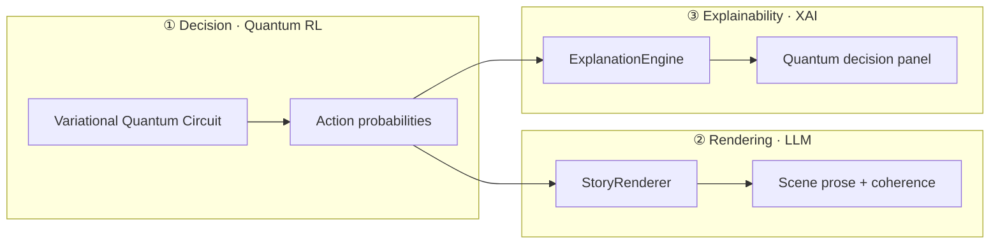
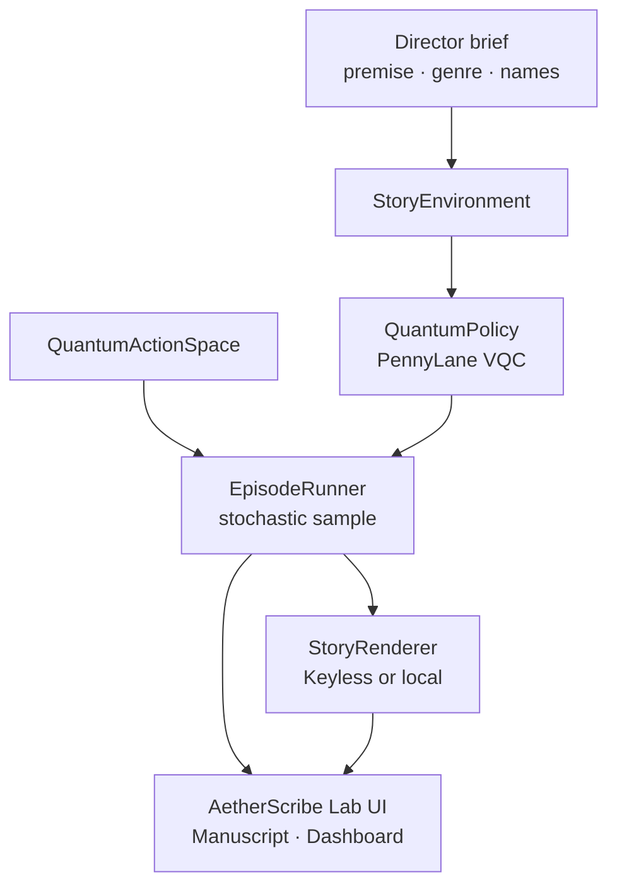
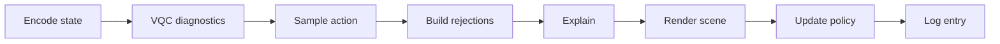

<div align="center">

# AetherScribe Lab

**Quantum Narrative Intelligence** · Master Render Edition

[](https://www.python.org/)
[](https://pennylane.ai/)
[](https://streamlit.io/)
[](#keyless-operation)

*Explainable multi-agent stories — quantum decisions first, prose second.*

[Quick Start](#quick-start) · [Features](#features) · [Architecture](#architecture) · [Explainability](#quantum-explainability) · [Docs](#documentation)

<br>

</div>

---

## Overview

**AetherScribe Lab** is a research platform for **explainable, multi-agent narrative generation**. A **Variational Quantum Circuit (VQC)** resolves *what happens* in each scene **before** any text is written. An LLM then renders locked actions into publication-style prose, while the UI surfaces a full audit trail: measured paths, alternate branches, posteriors, trait influence, and counterfactual rationale.

| | |
|:---:|:---|
| **Repository** | `quantum_rl` — Streamlit app, quantum policy, environment, LLM renderer, research dashboard |
| **Launch** | `streamlit run app.py` |
| **Remote** | [github.com/MUKILAN0608/AetherScribe](https://github.com/MUKILAN0608/AetherScribe) |

### How it differs from a plain LLM storyteller

```
  Typical LLM          →    free-form plot  →    opaque choices
  AetherScribe Lab     →    VQC measures    →    locked actions  →    explained prose
```

<br>

## Features

<table>
<tr>
<td width="50%" valign="top">

### Quantum policy
- 4-qubit narrative state encoding  
- Character trait biasing on the VQC  
- Joint action space (protagonist + antagonist + ally)  
- Stochastic measurement with honest posterior labels  

</td>
<td width="50%" valign="top">

### Narrative engine
- State-aware scene rendering (5–8 sentences per scene)  
- Premise-locked coherence scoring  
- Name detection from your director brief  
- Markdown · LaTeX · plain-text exports  

</td>
</tr>
<tr>
<td width="50%" valign="top">

### Explainability
- Per-scene **Quantum decision** cards  
- Chosen path · alternates · why-not analysis  
- Character influence bars  
- Sampling notes when peak ≠ selected  

</td>
<td width="50%" valign="top">

### Research dashboard
- Tension, coherence, utility, entropy, risk  
- Attribution, bonds, control heatmap  
- Trajectory embedding (PCA)  
- Audit log → `logs/research_audit.log`  

</td>
</tr>
</table>

<br>

## Quick start

### 1 · Install

```bash
git clone https://github.com/MUKILAN0608/AetherScribe.git
cd AetherScribe    # local folder may be quantum_rl
pip install -r requirements.txt
```

### 2 · Configure

Create `.env` in the project root from [.env.example](.env.example). The
configured local OLMoE MoE endpoint is the narrative renderer. Deterministic
output is development-only and cannot complete a manuscript:

```env
LLM_PROVIDER=local
NARRATIVE_LLM_PROVIDER=local
LOCAL_LLM_RUNTIME=llama_cpp
LOCAL_LLM_BASE_URL=http://127.0.0.1:8081/v1
LOCAL_LLM_MODEL_PATH=models/OLMoE-1B-7B-0125-Instruct.Q4_K_M.gguf
LOCAL_LLM_MODEL_NAME=OLMoE-1B-7B-0125-Instruct.Q4_K_M
LOCAL_LLM_CONTEXT_SIZE=4096
LOCAL_LLM_THREADS=4
LOCAL_LLM_GPU_LAYERS=all
LOCAL_LLM_DEVICE=Vulkan0
NARRATIVE_LOCAL_TEMPERATURE=0.7
NARRATIVE_TOP_P=0.8
NARRATIVE_MAX_OUTPUT_TOKENS=256
JEV_ENABLED=true
JEV_PROVIDER=openrouter
JEV_MODEL=meta-llama/llama-3.1-8b-instruct
JEV_API_KEY=your_openrouter_key
```

For OpenRouter-backed Jev, set `JEV_ENDPOINT` to
`https://openrouter.ai/api/v1/chat/completions` or leave it empty (the adapter
uses that default). Keep the key only in `.env` and never commit that file.
Jev is optional and cannot override a sampled quantum action; failures fall
back to local rules.

### 3 · Run

```bash
streamlit run app.py
```

For an offline smoke test and the existing quantum integration test:

```bash
python test.py
python tests/verify_system.py
```

### Local MoE model

Qwen3-30B-A3B was evaluated but cannot fit this laptop's current free disk
(its smallest listed GGUF is about 9GB; 6.9GB was free) or available RAM. The
configured alternative is OLMoE-1B-7B-0125-Instruct, a 7B-total/1B-active MoE,
Q4_K_M GGUF (4.21GB, Apache-2.0), served by llama.cpp with Vulkan offload on
the Intel Iris Xe. It fits the current disk and shared Vulkan-memory budget.
Download it once into `models/`:

```powershell
New-Item -ItemType Directory -Force models
curl.exe -L --fail -o models\OLMoE-1B-7B-0125-Instruct.Q4_K_M.gguf `
  https://huggingface.co/mradermacher/OLMoE-1B-7B-0125-Instruct-GGUF/resolve/main/OLMoE-1B-7B-0125-Instruct.Q4_K_M.gguf
```

The app reuses a healthy endpoint at `LOCAL_LLM_BASE_URL`; otherwise it starts
`llama-server` with `--n-gpu-layers all --device Vulkan0` from the configured
model path. Configure `LLAMA_SERVER_EXECUTABLE` if it is not on `PATH`. The UI
shows the discovered model ID and endpoint. A model mismatch or unavailable
provider is surfaced; it cannot silently count as a valid manuscript.

### Development fallback

Set `NARRATIVE_LLM_PROVIDER=deterministic` only for tests or offline interface
development. Its output is never accepted as a completed narrative.

### Local narrative mode

The local narrative path uses the configured OLMoE llama.cpp model without a hosted
API key. If the local model or server is unavailable, the UI reports that
failure; it does not count deterministic templates as accepted narrative.

### Optional hosted MoE narrative mode

To use the powerful hosted narrative model without loading it locally, set
`NARRATIVE_LLM_PROVIDER=openrouter` and provide `OPENROUTER_API_KEY`. The
default is `qwen/qwen3.5-35b-a3b`; the premium comparison model is configured
with `NARRATIVE_PREMIUM_MODEL` but is never called automatically. Jev remains
independent and continues using `JEV_MODEL` for structured decisions. The
default hosted request sets `NARRATIVE_REASONING_EFFORT=none` so the model
returns usable narrative content within the configured output budget.

### Measured example run

Run the complete interactive pipeline:

```powershell
python experiments\run_single_episode.py
```

Example answers:

```text
The last archivist discovers that a buried observatory can rewrite one historical event.
thriller
English
Mira
Voss
Nia
0.01
0.0
0.7
3
```

The runner reports each scene's locked quantum action, selected and peak
probabilities, Jev provider/model/latency, narrative provider/model/latency,
available token usage, utility, and the SQLite episode ID. Coherence is shown
only when an evaluator actually measured it. The audit is stored in
`aetherscribe_lab.db`.

### Persistent narrative memory

Structured memory is enabled by default and stored in the same SQLite database.
Each record is scoped to a `story_id`, carries category, confidence, origin,
scene provenance, and status, and is retrieved with a bounded deterministic
ranking before rendering. Memory is advisory only; the sampled VQC action is
passed as an immutable mapping and is checked after rendering.

Set `NARRATIVE_MEMORY_ENABLED=false` to reproduce the baseline memory-off path.
The Streamlit sidebar provides **Continue story memory**; leave it unchecked
for a new isolated story and select it only when intentionally continuing the
current story. Memory failures fall back to rendering without memory and are
recorded in the scene audit.

Accepted scenes are also persisted in bounded story history. Exact duplicates,
repeated openings, highly similar recent scenes, and repeated action beats
receive one bounded retry with a new-development warning. If repetition
persists, an action-preserving fallback is used and the rejection is recorded.
History is isolated by `story_id`.

The continuity trace records the current situation, protagonist goal, facts,
character knowledge, unresolved conflicts, previous outcome, and next scene
purpose. Run `python -m pytest -q --basetemp .pytest-tmp` to validate the
continuity and anti-repetition regression suite.

### Structured secret ledger and reveal gate

Stage 4 adds a story-scoped SQLite secret ledger and deterministic reveal gate.
Secrets can be constrained by minimum scene, required event, character
knowledge, prerequisite secret, and explicit instruction. Eligibility is not
automatic disclosure: the renderer receives only bounded policy guidance.

If a renderer emits a hidden canonical value or alias, prose validation rejects
the draft and produces an action-preserving safe fallback. Gate or ledger
failures also fail closed. The Dashboard's **Secret reveal gate** panel shows
counts, statuses, and redacted reasons without exposing canonical values.

Configuration:

```env
NARRATIVE_SECRET_LEDGER_ENABLED=true
NARRATIVE_REVEAL_GATE_ENABLED=true
NARRATIVE_SECRET_STRICT_VALIDATION=true
```

Run the Stage 4 regression suite:

```powershell
python -m pytest -q --basetemp .pytest-tmp
python tests\verify_system.py
```

See [stage4-report.md](stage4-report.md) for execution order, adversarial leak
testing, measured evidence, and known limitations.

| Step | Action |
|:----:|--------|
| 1 | Enter a **premise** with character names |
| 2 | Click **Detect names from premise** (optional) |
| 3 | Choose genre, language, and scene count (6–12) |
| 4 | Click **Generate** — review **Manuscript** and **Dashboard** |

<br>

## Architecture

### Triad of authority

AetherScribe separates responsibilities so no single layer can silently override the others.



| Authority | Components | Rule |
|-----------|------------|------|
| **Decision** | `QuantumPolicy`, `QuantumActionSpace`, `EpisodeRunner` | Plot branch chosen **before** text generation |
| **Rendering** | `StoryRenderer` | Prose must follow locked joint actions |
| **Explainability** | `ExplanationEngine`, `ui/decisions.py`, `ui/quantum_panel.py` | Every measure has rationale + counterfactuals |

### System flow



### State encoding (4 qubits)

| Feature | Role |
|---------|------|
| **Tension** | Dramatic intensity ∈ [0, 1] |
| **Phase** | Arc position — intro / rising / climax |
| **Progress** | `step / max_steps` |
| **Genre** | Thriller, horror, drama, fantasy, … |

**Reward:** `composite_reward = env_reward × coherence_score`

<br>

## Quantum explainability

Open **Manuscript → Scenes & quantum trace** and expand any scene.

<div align="center">

| Selected P | Peak P | Entropy | Coherence |
|:----------:|:------:|:-------:|:---------:|
| Branch used in the story | Highest in superposition | Spread of distribution | Prose ↔ action fit |

</div>

### Panel at a glance

| Section | What you see |
|---------|----------------|
| **Legend** | How to read posteriors (high alternate % ≠ bug) |
| **Metrics** | Selected P · Peak P · entropy · risk · margin ΔP · coherence |
| **Sampling note** | When measured branch &lt; VQC peak — stochastic draw explained |
| **Chosen path** | Measured joint action per character name |
| **Policy rationale** | Tension, traits, disposition, narrative phase |
| **Character influence** | Normalized influence bars |
| **Alternates** | Top paths not chosen + full why-not paragraphs |
| **Narrative trace** | One-sentence summary of the measured path |

<details>
<summary><strong>Metric definitions</strong></summary>

<br>

| Metric | Meaning |
|--------|---------|
| **Selected branch P** | Posterior of the **sampled** joint action used in the scene |
| **Peak branch P** | Maximum posterior over **all** joint actions |
| **Entropy** | Shannon entropy of the action distribution |
| **Risk** | Policy risk diagnostic from the VQC step |
| **Margin ΔP** | Gap between 1st and 2nd largest posterior |
| **Coherence** | LLM score for prose ↔ measured action alignment |

</details>

<details>
<summary><strong>Why selected P can be lower than an alternate (FAQ)</strong></summary>

<br>

**Question:** *Chosen path shows 13% but an alternate shows 49% — is the data wrong?*

**Answer:** No. That is **correct AetherScribe behavior.**

```python
# evaluation/episode_runner.py
action_idx = int(np.random.choice(len(probs), p=probs))
```

The VQC outputs a full distribution; the story **samples** one joint action. The **peak** branch is the mode; the **measured** branch is the draw used for rendering. The UI shows **Selected branch P** vs **Peak branch P** plus a sampling note when they diverge.

For deterministic (always argmax) experiments, use `int(np.argmax(probs))` in `episode_runner.py` and note that in any publication.

</details>

<br>

## AetherScribe Lab UI

### Sidebar — director brief

| Control | Purpose |
|---------|---------|
| **Premise** | Story setup with character names |
| **Detect names** | Deterministic local heuristics |
| **Characters** | Protagonist · antagonist · ally display names |
| **Genre / language / scenes** | 6–12 scenes per episode |
| **Generate** | Full run at `render_depth="full"` |

### Tabs

| Tab | Contents |
|-----|----------|
| **Manuscript** | KPI strip · full story · per-scene prose + quantum trace |
| **Dashboard** | Plotly telemetry with your character names on every chart |

### Manuscript exports

| Function | Output |
|----------|--------|
| `compile_full_manuscript()` | Continuous story text |
| `compile_plain_text_export()` | Plain-text archive |
| `generate_manuscript_markdown()` | Structured Markdown |
| `generate_manuscript_latex()` | LaTeX for papers |

<br>

## Dashboard telemetry

| Theme | Charts |
|-------|--------|
| **Narrative dynamics** | Tension · coherence · utility · decision margin ΔP |
| **Quantum diagnostics** | Posterior per scene · entropy · risk |
| **Characters** | Trait pulse · attribution pie · trust / enmity bonds |
| **Structure** | Control heatmap · trajectory embedding (PCA) |

<br>

## Episode pipeline



Each scene log includes: `probs`, `action_idx`, `attribution`, `rejections`, `rationale`, `story`, `coherence`, `weights`, and more.

<br>

<details>
<summary><strong>Configuration & environment variables</strong></summary>

<br>

| Variable | Purpose |
|----------|---------|
| `NARRATIVE_LLM_PROVIDER` | `deterministic`, `local`, or optional OpenRouter |
| `LOG_LEVEL` | Logging verbosity |
| `DATABASE_URL` | Default `sqlite:///./aetherscribe_lab.db` |

**Render depth** (`evaluation/episode_runner.py`):

| Mode | Behavior |
|------|----------|
| `full` | Scene + coherence + rejection LLM *(app default)* |
| `standard` | Scene + coherence; template rejections |
| `fast` | Scene only; heuristic coherence |

**Hyperparameters** (`app.py`): `lr=0.01` · `eps=0.01` · `temperature=0.88`

> Never commit `.env` to Git. Rotate keys if exposed.

</details>

<details>
<summary><strong>Project structure</strong></summary>

<br>

```
quantum_rl/
├── app.py                    # Streamlit entry
├── quantum_policy/           # VQC · action space
├── environment/              # Story physics · state encoding
├── agents/                   # Trait matrices
├── llm/                      # Renderer · prompts · entity extraction
├── explainability/           # Rationale engine
├── evaluation/               # Episode runner · database
├── ui/                       # Manuscript · dashboard · quantum panel
├── experiments/              # CLI runner
└── tests/                    # verify_system.py
```

See also `TECHNICAL_SPEC.md` and `DETAILED_SYSTEM_FUNCTIONALITY.txt`.

</details>

<details>
<summary><strong>Troubleshooting</strong></summary>

<br>

| Symptom | Fix |
|---------|-----|
| Empty / short scenes | Check the selected local provider and prompt contract |
| Selected P &lt; alternate P | Expected — see [FAQ above](#quantum-explainability) |
| Truncated why-not text | Regenerate — old Streamlit session data |
| Empty charts | Complete a full episode first |
| Wrong names | **Detect names from premise** → **Generate** again |

</details>

<br>

## Development

### Narrative coordination and world research stages

Stages 4–8 provide versioned coordinator commits, a structured world snapshot with USDA text export, a read-only visual-observer adapter, explicitly hypothetical future branches, and event-grounded character adaptation. Their current capabilities and environmental limits are documented in [STAGES_4_8_IMPLEMENTATION.md](STAGES_4_8_IMPLEMENTATION.md). OpenUSD SDK, Omniverse, and semantic vision support are optional; the app reports unavailable integrations instead of simulating them.

```bash
python tests/verify_system.py
python experiments/run_single_episode.py
```

Audit trail: `logs/research_audit.log` · logger `AetherScribeLab`

<br>

## Documentation

| Resource | Description |
|----------|-------------|
| [TECHNICAL_SPEC.md](TECHNICAL_SPEC.md) | Architecture specification |
| [DETAILED_SYSTEM_FUNCTIONALITY.txt](DETAILED_SYSTEM_FUNCTIONALITY.txt) | Full v6.0 academic reference |

### Citation

```bibtex
@software{aetherscribe2026,
  author = {Mukilan},
  title = {AetherScribe Lab: Quantum Narrative Intelligence System},
  year = {2026},
  version = {6.0},
  url = {https://github.com/MUKILAN0608/AetherScribe}
}
```

> We generated narratives using AetherScribe Lab (v6.0), a quantum reinforcement learning framework that resolves joint character actions via a variational quantum circuit before LLM rendering, with per-scene explainability over posteriors and counterfactual branches.

<br>

---

<div align="center">

**AetherScribe Research** · Master Render Edition v6.0

*Quantum Narrative Intelligence*

<br>

[](https://github.com/MUKILAN0608/AetherScribe)

</div>
